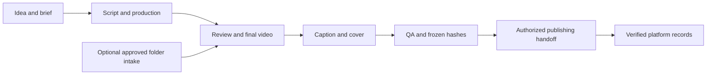

# Video Content Workflow

A reusable agent skill for **idea → video production → caption and cover → verified publishing handoff**. You can also start from an existing final video.

Built from a working content pipeline, with brand choices separated from reusable mechanics. Supports product demonstrations, tutorials, educational clips, stories, and other short-form videos. Movie-based education is one optional example.



## Included

- Tool-independent creative and production guidance, starting before the video exists.
- Configurable audience, language, voice, style, review gates, accounts, and schedule.
- Python helper for jobs, media checks, SHA-256 deduplication, immutable handoffs, atomic writes, and independent platform attempt records.
- Procedures for folder intake, cross-chat handoffs, optional native music, and uncertain-result recovery.
- No private account data, chat IDs, credentials, footage, or copyrighted sample media.

This is a **skill and local coordination helper**. Your agent's available tools render videos/images, download files, and operate publishing services. No editor, AI model, Drive downloader, uploader, or always-on hosting is bundled. Optional intake needs a provider adapter and persistent run lease in the host environment.

## Install

Copy the repository into your agent's skills directory as `video-content-workflow`. Codex commonly uses `~/.codex/skills/` or `$CODEX_HOME/skills/` when customized. Reload skill discovery if required by your host.

```sh
git clone https://github.com/bubeishisuqiangua/video-content-workflow.git ~/.codex/skills/video-content-workflow
```

Ask your agent:

> Use $video-content-workflow to make a tutorial for my app. Start with the concept and video, then create the caption and cover. Keep publishing as a draft until I approve it.

Or continue final videos under an existing authorized workflow. Installation grants no account access or publishing permission. One chat can do all stages; separate chats are optional.

## Helper quick start

Requires Python 3.10+. Media validation needs FFmpeg/ffprobe on PATH. Windows may need optional `tzdata` for IANA timezones; otherwise no third-party Python dependencies.

Use a project directory **outside the installed skill**:

```sh
python scripts/workflow.py --root /path/to/my-project init
# Edit the generated workflow.json for the actual brand before creating jobs.
python scripts/workflow.py --root /path/to/my-project create first-demo --title "A useful shortcut" --brief "Show one real task and its result."
python scripts/workflow.py --root /path/to/my-project start first-demo
```

Publishing starts disabled with no accounts. Render using your preferred tools, then follow the [operations guide](references/operations.md) to attach the video, caption, cover and QA report. Runtime data stays in that separate project.

The helper enforces transitions and byte integrity. Reviewers establish creative quality, rights, authorization, and live-platform facts. It never posts on its own. Version one supports one video per day per platform/account.

## Develop

```sh
python -m unittest discover -s tests -v
```

Tests use temporary projects, never contact live platforms, and generate their own media fixtures with FFmpeg. Integration tests skip if FFmpeg is unavailable. See [SKILL.md](SKILL.md) for the agent entry point and [中文说明](README.zh-CN.md).

For a manual offline rehearsal, initialize a separate project with `init --simulation`. Its job records are explicitly labeled; do not perform real platform actions from a simulation project.

MIT licensed. Third-party media, music, trademarks, and platform rights are not covered by this license.
